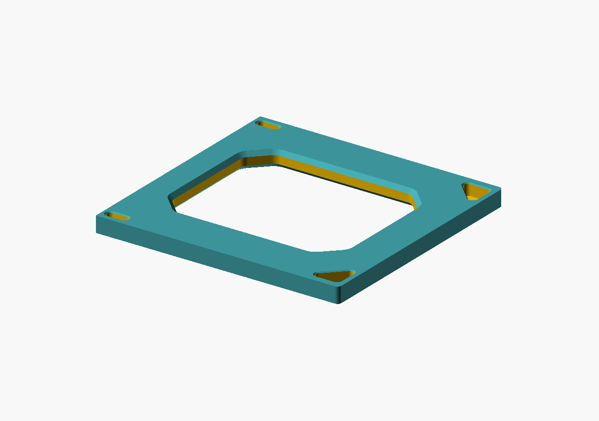
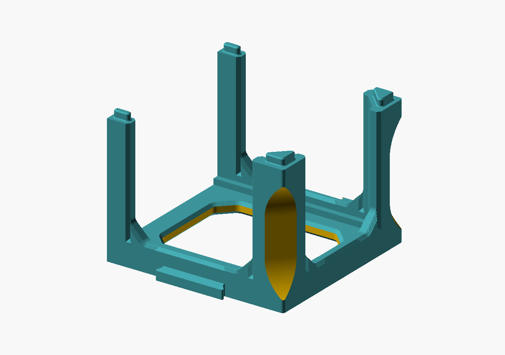
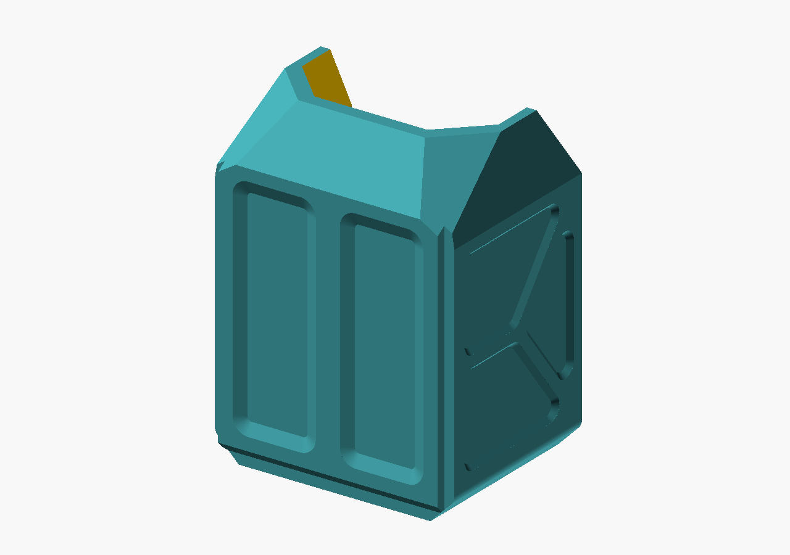
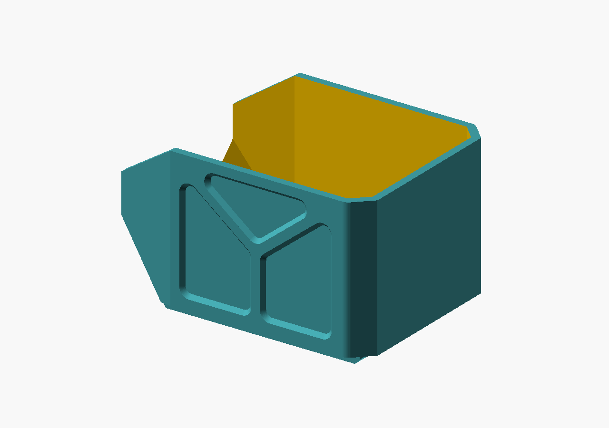
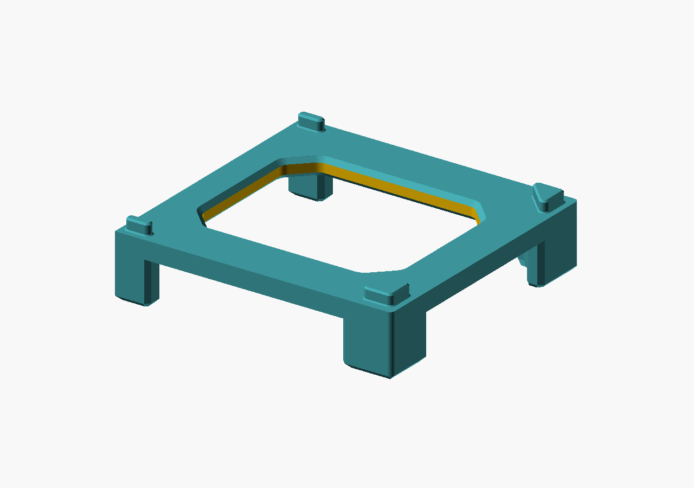
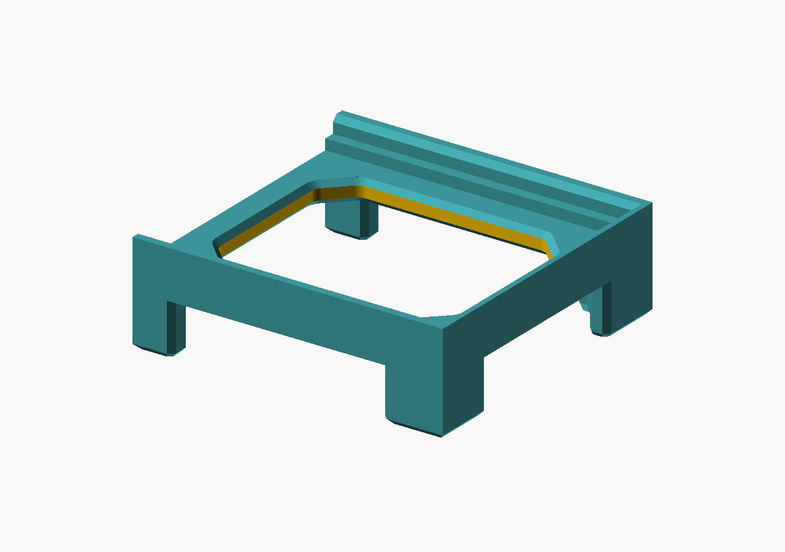

# Kệ khay xếp chồng — danh mục chi tiết có ảnh

Dùng mã **CT01–CT05** và tên tiếng Việt dưới đây khi trao đổi hoặc yêu cầu sửa mô hình. Mã CT là mã tài liệu ổn định; tên trong dấu `backtick` là giá trị `part` thật trong [stackable-bin-rack.scad](../stackable-bin-rack.scad), selector giữ nguyên trong source.

Ảnh được render trực tiếp từ source hiện tại ngày **26/10/2026**, với `size=[1,1,1]`, backend Manifold và tư thế hình học của selector. Mỗi ảnh tự căn vừa khung nên không dùng ảnh để so tỷ lệ giữa các chi tiết. Màu chỉ giúp nhận diện bề mặt; tư thế đặt lên bàn in được ghi riêng bên dưới.

## Danh mục

| Mã | Ảnh | Tên chi tiết / selector | Vai trò, khớp tiếp xúc và tư thế in |
| :--- | :---: | :--- | :--- |
| <a id="ct01"></a>**CT01** | <a href="parts/cap.png"></a> | **Nắp chụp trên**<br>`cap` | Tấm chụp trên cùng, có cửa sổ lớn và bốn ổ socket nhận các đầu locator của frame. In phẳng theo tấm, mặt tấm nằm trên bàn; khi lắp trong `assembly`, nắp được lật để socket úp xuống đầu chốt frame. Bao 1×1×1: **124 × 119,93 × 8 mm**. STL: [cap.stl](../exports/size-multiplier/1x1x1/cap.stl). |
| <a id="ct02"></a>**CT02** | <a href="parts/frame.png"></a> | **Khung kệ**<br>`frame` | Khung chịu lực của mỗi ô: tấm, ray trước/sau, cột góc, dovetail nối cạnh, bốn socket phía dưới và bốn đầu locator phía trên. Đầu locator ghép vào socket của frame/nắp kế tiếp; các gờ trong đỡ CT03. In base-down theo tấm và các cột dựng lên. Bao 1×1×1: **124 × 124,93 × 96 mm**. STL: [frame.stl](../exports/size-multiplier/1x1x1/frame.stl). |
| <a id="ct03"></a>**CT03** | <a href="parts/bin.png"></a><br><a href="parts/bin-use.png"></a> | **Khay chứa**<br>`bin` | Khay mở miệng và mở phía trên theo hình học source, có đáy, thành nghiêng, vai, mái/lip và các mặt panel. Ảnh trên là tư thế in; ảnh dưới dùng đúng biến đổi `bin_in_frame()` của source để thấy lòng và miệng khi sử dụng. Trong cụm, mặt sau tựa về ray **+X**, miệng hướng **−X**; các gờ/ledge của CT02 hoặc CT05 đỡ và dẫn khay khi trượt vào. Bao print-axis 1×1×1: **100 × 80 × 135 mm**; kích thước sử dụng theo quy ước là **dài 100L × sâu (100D+35) × cao 80H mm**. STL: [bin.stl](../exports/size-multiplier/1x1x1/bin.stl). |
| <a id="ct04"></a>**CT04** | <a href="parts/stand.png"></a> | **Đế đỡ khung**<br>`stand` | Đế được dựng độc lập cho CT02 bằng vòng tấm dày 8 mm, cửa sổ vát, bốn chân và bốn đầu locator hướng lên. Đầu locator ghép vào socket dưới CT02; selector đặt chân xuống bàn (`foot_h=20`). Bao 1×1×1 gồm phần chốt: **124 × 120 × 33 mm**. STL: [stand.stl](../exports/size-multiplier/1x1x1/stand.stl). |
| <a id="ct05"></a>**CT05** | <a href="parts/stand_bin.png"></a> | **Đế đỡ khay**<br>`stand_bin` | Đế thấp đặt trực tiếp dưới CT03 gồm vòng tấm inset **4 mm**, ray/gờ tựa trước-sau, ledge trong, stop rail phía sau và bốn chân liền khối. Các khoảng mở giữa ray tạo đường nhận và dẫn CT03; khay trượt trên ledge và dừng ở stop rail. Selector đặt chân xuống bàn với cùng gầm danh nghĩa 20 mm. Bao 1×1×1: **116 × 112 × 38 mm**. STL: [stand_bin.stl](../exports/size-multiplier/1x1x1/stand_bin.stl). |

## Quy ước kích thước và vị trí

Đơn vị là mm. `size=[L,D,H]` lần lượt là số ô theo **dài**, **sâu**, **cao**. Quy ước kích thước sử dụng của khay là:

`dài = 100L`, `sâu = 100D + 35`, `cao = 80H`.

Phần nhô giữ **35 mm khi D thay đổi**. Trong tư thế in của source, các trục không trùng với ba trục sử dụng: dài đi theo Y của cap/frame và X của bin; sâu đi theo X của cap/frame và Z của bin; cao đi theo Z của frame và Y của bin. `span(n)=120+100(n-1)` là chiều Y của tấm cap/frame/stand theo số ô dài; `plate_w=124+100(D-1)` là chiều X của tấm theo số ô sâu. CT04 và CT05 dùng `foot_h=20`, tức khoảng từ mặt bàn đến mặt dưới tấm đế. Chân đã đưa sát góc của từng tấm đế; CT04 chỉ giữ sai lệch dựng hình 0,01 mm theo X. Cả hai mẫu không còn gân tam giác nối chân với đế; vát đáy chân 2 mm giữ nguyên.

| Chi tiết | Bao 1×1×1 trong STL canonical | Các mặt/khớp chính |
| :--- | :---: | :--- |
| CT01 — `cap` | 124 × 119,93 × 8 | Cửa sổ, bốn socket tam giác bo/stadium; `socket_r=2,1 mm` là bán kính offset/bo của profile locator, chiều sâu socket 6 mm. |
| CT02 — `frame` | 124 × 124,93 × 96 | Ray cao 18 mm, bốn socket dưới, bốn locator trên; cột trên cùng ở `post_top=91` mm và đầu chốt cao thêm 5 mm. |
| CT03 — `bin` | 100 × 80 × 135 | Thành 4 mm, đáy 4 mm; hai mặt facet trong khoảng 41,47° là vùng cần lưu ý khi slice. |
| CT04 — `stand` | 124 × 120 × 33 | Tấm dày 8 mm, bốn chân, bốn locator; khe kiểm tra hướng kính frame/stand xấp xỉ 0,1 mm và khe đầu chốt 1 mm trong audit. |
| CT05 — `stand_bin` | 116 × 112 × 38 | Tấm inset 4 mm, ledge khoảng 609,97 mm² và stop khoảng 320 mm² trong audit 1×1×1; bốn chân, gầm 20 mm. |

Các kích thước bao là số đo hình học của mesh đã xuất, không phải dung sai sau in. Dung sai dovetail, socket, gờ khay và độ chặt khi in cần mẫu thử vật lý.

## STL canonical và nhận dạng revision

Bộ canonical cho `size=1x1x1` nằm trong [exports/size-multiplier/1x1x1](../exports/size-multiplier/1x1x1/). Hash source hiện tại đã xác minh là:

`9E519D4E3312E77B0DE24FFB8A723AFE75BC02D0FB733013B7B6C5CB413130C9`

Manifest tổng hợp [exports/size-multiplier/manifest.json](../exports/size-multiplier/manifest.json) ghi cùng source hash và hash từng STL. Hash SHA-256 canonical 1×1×1:

| Selector | STL | SHA-256 |
| :--- | :--- | :--- |
| `cap` | [cap.stl](../exports/size-multiplier/1x1x1/cap.stl) | `D96A7A1DE486CD1743C26D0AB4BB7BCA377A34EFDCD55F930CD00610C4075EE9` |
| `frame` | [frame.stl](../exports/size-multiplier/1x1x1/frame.stl) | `47D5D78DD22E735A01EB2F699C5CD7F81EE414D0CEC727388042ECD2AEC610F5` |
| `bin` | [bin.stl](../exports/size-multiplier/1x1x1/bin.stl) | `0D05C9683990DF69FAA9CFD1A9D80D5D62D920CB046E826E7EA188F12B0B8437` |
| `stand` | [stand.stl](../exports/size-multiplier/1x1x1/stand.stl) | `5E2BF02A78757DE6F62F8D14142D59D8E54A29EA5499450D814FF78DD3106A8D` |
| `stand_bin` | [stand_bin.stl](../exports/size-multiplier/1x1x1/stand_bin.stl) | `C5A1B1388E1DECA839A9CFFBB3460F69471E69EA402038E181F6C659DE3BA912` |

## Tư thế in và bằng chứng FDM

Đây là tư thế canonical của selector, tách khỏi các pose do Auto Orient chọn:

- **CT01 — `cap`:** tấm phẳng; audit Auto Orient giữ tư thế phẳng. Không thấy patch hướng xuống dưới 44,5°; mép cửa sổ nằm trong dải gần 45°.
- **CT02 — `frame`:** tấm nằm trên bàn, cột dựng lên. Bốn mái socket ngang ở Z=6 mm và các slot hẹp tạo đường bridge; chất lượng bridge sau in chưa được xác minh.
- **CT03 — `bin`:** đáy xuống bàn, bao 100×80×135 mm ở 1×1×1. Audit ghi hai mặt facet trong khoảng **41,4729°**, khoảng 612,07 mm² mỗi mặt; mái/lip chính 45°, dốc trước 56,31°, vai khoảng 80,54°. Đây là cảnh báo hình học bảo thủ, không phải kết luận chắc chắn lỗi in.
- **CT04 — `stand`:** chân xuống bàn, locator hướng lên; canonical có mặt dưới lớn ở cao độ gầm 20 mm. Auto Orient của audit chọn pose nằm cạnh, còn slice không support phát cảnh báo cantilever; bản support-enabled/support45 đã xóa cảnh báo cụ thể đó.
- **CT05 — `stand_bin`:** chân xuống bàn, ray/stop hướng lên để đỡ khay. Auto Orient cũng chọn pose nằm cạnh và slice không support cảnh báo cantilever; support-enabled/support45 đã xóa cảnh báo cụ thể đó.

Hồ sơ revision trước có 35 mesh (5 part × 7 size), sáu pose trục chính và 10 job slice: 5 baseline tắt support, 5 variant support45 (gồm 2 pose stand chân xuống bàn). Slice đã dùng **custom PETG `NhietGiam` 230/210°C, flow 16**. `support45` là một **variant toàn bộ profile do audit chọn**, gồm bật support, đổi kiểu support và ngưỡng góc. Bản tóm tắt public tại [docs/validation/summary.md](validation/summary.md); bridge, cantilever, bề mặt 41,47°, tháo support, độ vừa và độ bền vật lý giữ trạng thái `not_run`.

## Trạng thái kiểm chứng

- **Geometry/source:** ma trận 7 size, 35 part mesh kín một shell, winding nhất quán, không mặt suy biến; hai đế có bốn chân và khoảng hở mặt bàn–mặt dưới tấm đúng 20,0 mm. Kiểm tra locator frame/stand, gờ và stop của bin, insertion/slide mẫu đã có trong audit local.
- **Slice:** các số liệu và giới hạn công khai nằm trong [validation/summary.md](validation/summary.md). Đây là bằng chứng slice offline với profile nêu trên, không phải bằng chứng sản phẩm đã in.
- **Physical/live:** chưa có xác nhận in thật, đo dung sai sau in, chất lượng bridge/cantilever, lực lắp, tải hoặc độ bền; Fusion native của revision này cũng giữ trạng thái `not_run`.

## Lệnh tái tạo ảnh, selector và hash

Dùng đúng OpenSCAD và Python runtime của project:

```powershell
$root = (Get-Location).Path
$o = if ($env:OPENSCAD_BIN) { $env:OPENSCAD_BIN } else { 'openscad.com' }
$py = if (Get-Command python -ErrorAction SilentlyContinue) { 'python' } else { 'py' }
& $o --version

# Render năm ảnh chi tiết và một ảnh bin ở tư thế sử dụng vào docs/parts;
# manifest ghi command, selector transform và source hash.
& $py "$root\tools\render-parts-catalogue.py"

# Kiểm tra manifest đã render đủ và đúng năm selector.
$render = Get-Content "$root\docs\parts\render-manifest.json" | ConvertFrom-Json
$render | Select-Object -ExpandProperty selector

Get-FileHash -Algorithm SHA256 "$root\stackable-bin-rack.scad"
Get-FileHash -Algorithm SHA256 -Path "$root\exports\size-multiplier\1x1x1\*.stl"
```

Ảnh catalogue và manifest public: [parts/cap.png](parts/cap.png), [parts/frame.png](parts/frame.png), [parts/bin.png](parts/bin.png), [parts/bin-use.png](parts/bin-use.png), [parts/stand.png](parts/stand.png), [parts/stand_bin.png](parts/stand_bin.png), [parts/render-manifest.json](parts/render-manifest.json). Log render local không nằm trong snapshot.
